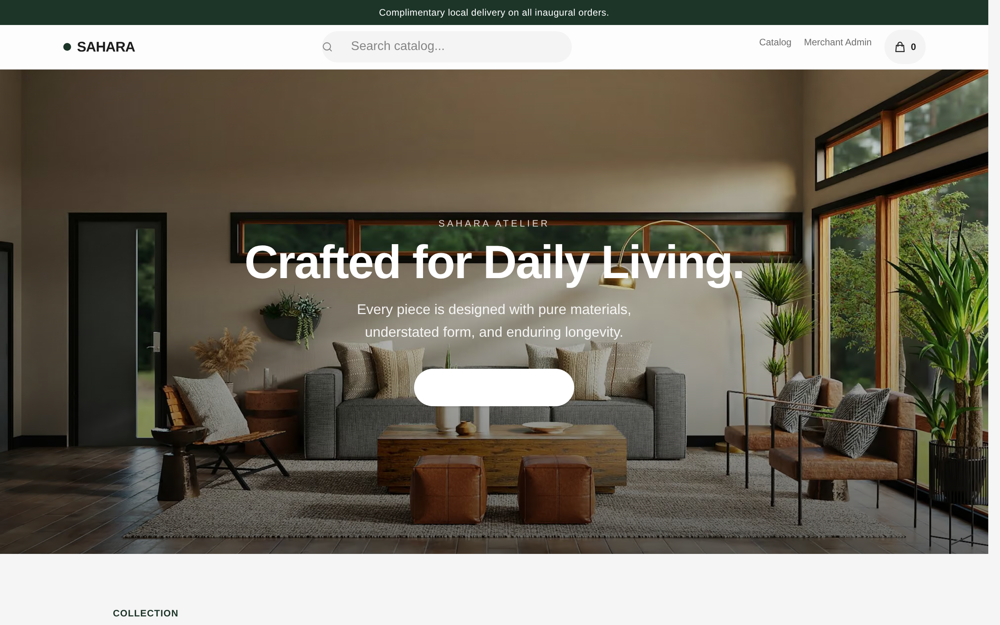
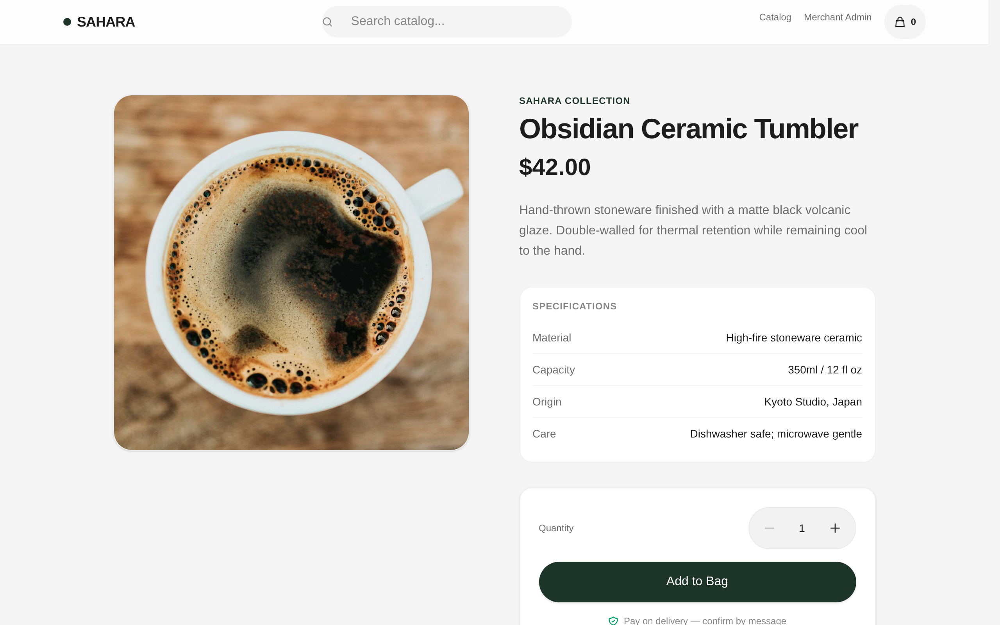
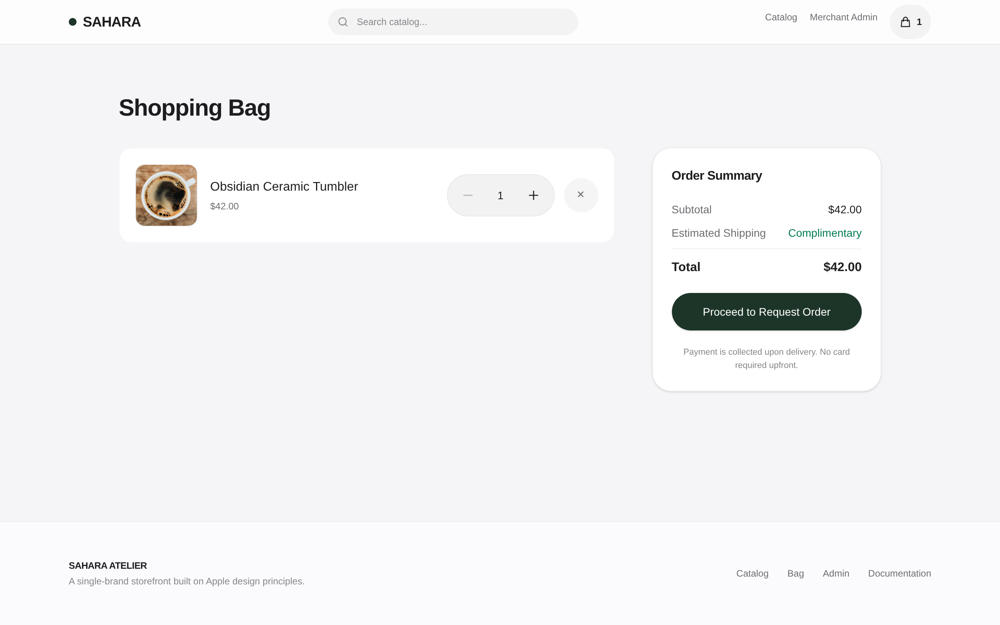
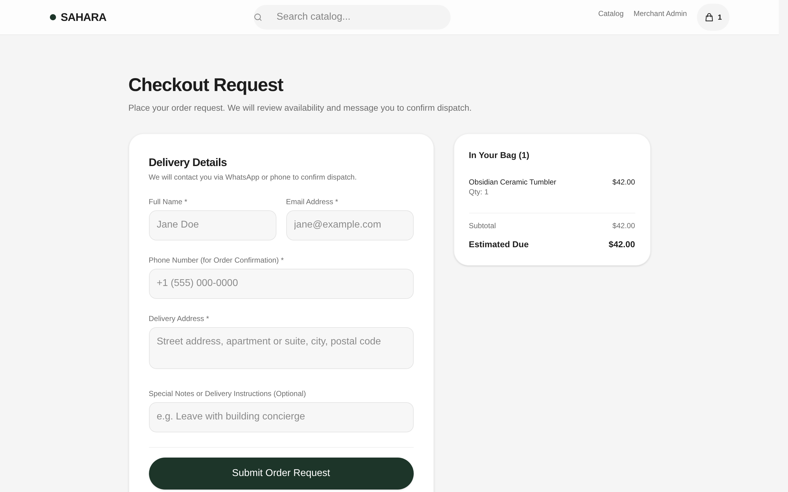
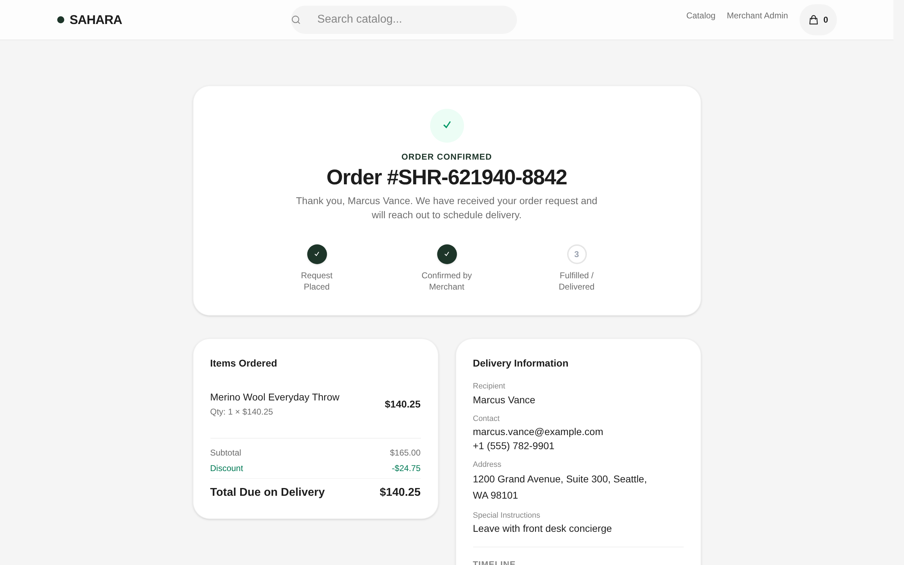
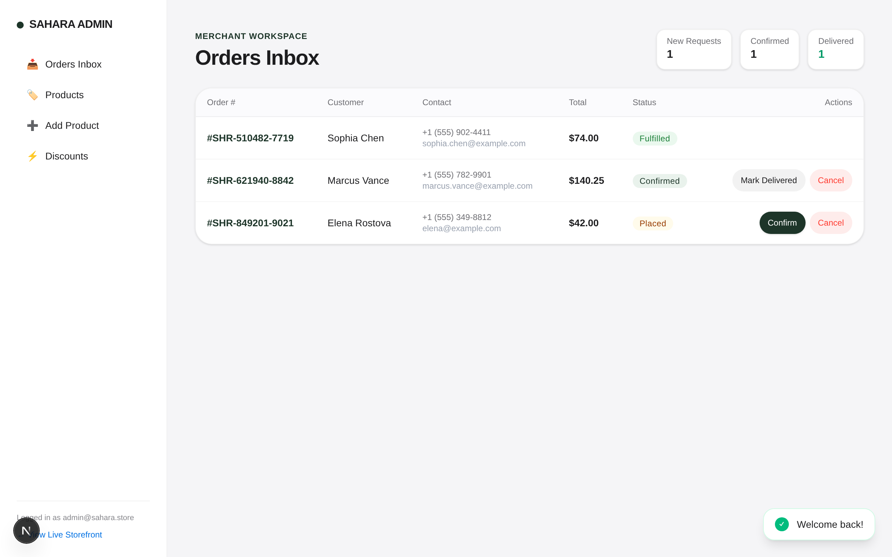
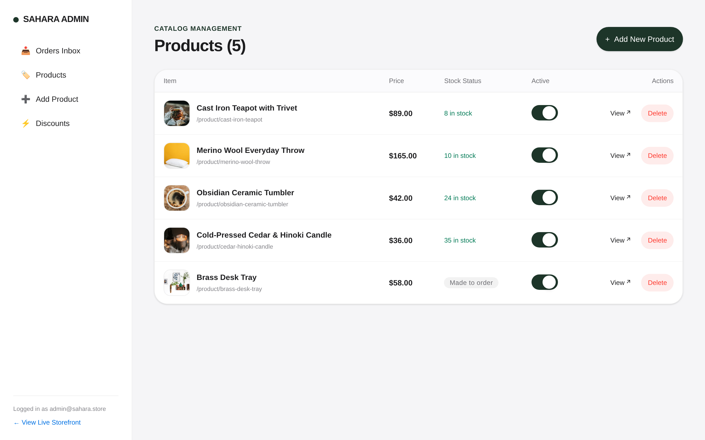
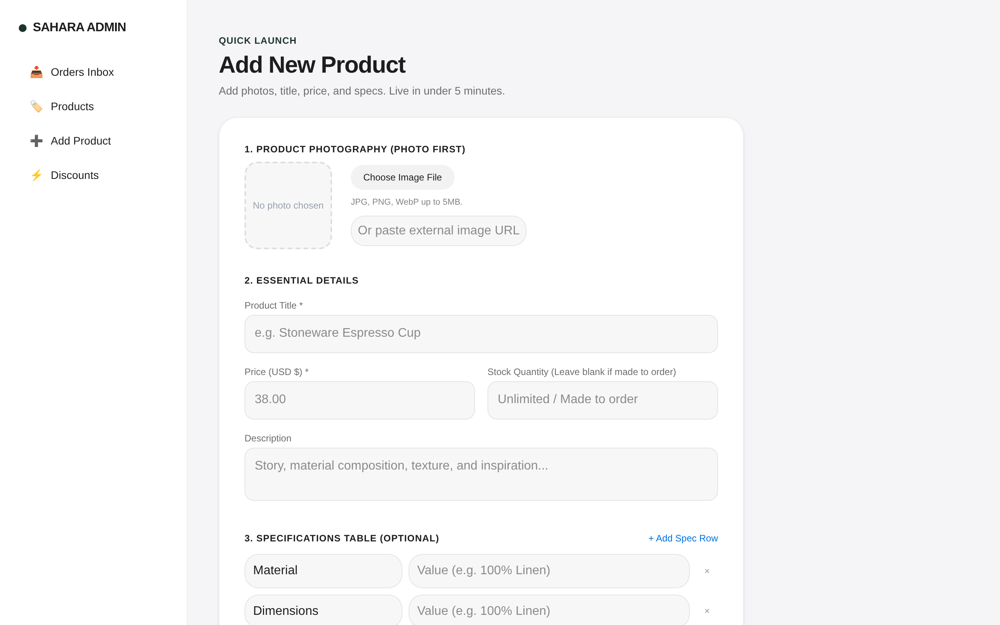
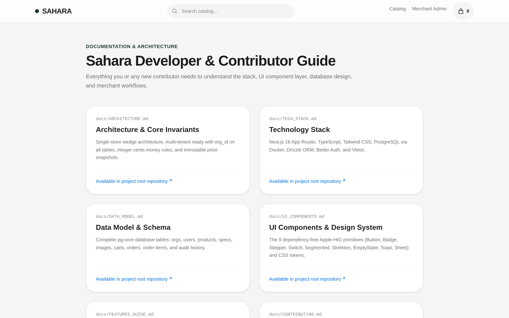

# Sahara — Single-Brand E-Commerce Storefront

<p align="center">
  
</p>

<p align="center">
  <strong>An Apple-HIG inspired digital storefront engineered for independent brands and creators migrating from Instagram DMs and chat threads into an owned, refined shopping experience.</strong>
</p>

<p align="center">
  
  
  
  
  
  
  
</p>

---

## 📽️ Live Walkthrough & Video Demonstration

* **Animated Walkthrough**: Included above (`public/docs/screenshots/sahara-walkthrough.gif`)
* **High-Definition Video Demo**: [`public/docs/screenshots/sahara-demo.mp4`](public/docs/screenshots/sahara-demo.mp4) (Download or open to view the complete end-to-end buyer and merchant flow in 1080p).

---

## 📸 Visual Showcase

| 1. Full-Bleed Hero & Collection | 2. Product Detail & Technical Specs |
|:---:|:---:|
|  |  |
| **3. Shopping Bag** | **4. Request-Order Checkout** |
|  |  |
| **5. Live Order Status Stepper** | **6. Merchant Orders Inbox (Money First)** |
|  |  |
| **7. Catalog Management** | **8. 5-Minute Add Product Form** |
|  |  |
| **9. In-App Documentation** | |
|  | |

---

## ✨ Key Features

### For Shoppers (Buyer Arc)
- **Persuade Landing**: Full-bleed lifestyle hero banner anchoring directly into an airy, calm product collection (`#catalog`).
- **Deep Technical Specifications**: Products feature hairline key/value specification tables (materials, dimensions, origins, care).
- **Subtle Dynamic Discounts**: Automatic percentage and fixed-amount savings calculations with crossed-out original prices.
- **Cash / Transfer on Delivery**: No upfront credit card barrier. Customers place an "order request" and settle payment upon delivery.
- **Live Status Stepper**: Real-time order tracking: `Request Placed` ➔ `Confirmed by Merchant` ➔ `Fulfilled / Delivered`.
- **Verified Reviews**: Community reviews with 5-star ratings and feedback submissions.

### For Merchants (5-Minutes-to-Live Arc)
- **Orders Inbox First (`/admin`)**: Land immediately on revenue operations. Confirm, fulfill, or cancel orders in a single click with audit timestamps.
- **Photo-First Cataloging**: One-screen product creation form (`/admin/products/new`) with instant file upload or image URL embedding, title, dollar pricing, inventory limits, and dynamic specs.
- **Promotions Engine (`/admin/discounts`)**: Configure percentage or fixed promotional price reductions across any catalog item.
- **Quick Catalog Toggles**: Instantly pause or activate items from the live storefront.

---

## 🏛️ Architecture & Financial Invariants

1. **Integer Cents Money Model**: Float arithmetic is banned. All prices, discounts, and order totals are computed and stored as integer cents (e.g. `$42.00` = `4200`).
2. **Immutable Price Snapshots**: Line item base prices, discounts, and net totals are permanently snapshotted into `order_items` during checkout to guarantee historic reporting integrity.
3. **Multi-Tenant Foundation**: Every tenant table carries `org_id` from migration #1. Transitioning from a single brand to a multi-merchant marketplace is purely additive.
4. **Order State Machine**: Enforces valid forward status transitions (`placed → confirmed → fulfilled | cancelled`) and logs every mutation to `order_status_history`.
5. **Security Hardening**:
   - Better Auth with client-tamper-proof roles (`input: false` on `role`).
   - Magic-byte binary verification on file uploads (JPEG, PNG, WebP) with strict extension derivation.
   - Session-scoped cart mutations preventing IDOR tampering.

---

## ⚡ Quickstart

### Prerequisites
- Node.js `v20+` or `v26+`
- `pnpm` (`v10+` or `v12+`)
- `docker` and `docker compose`

### 1. Clone & Install
```bash
git clone https://github.com/paramcodes/sahara.git
cd sahara
pnpm install
```

### 2. Launch Local PostgreSQL
```bash
docker compose up -d
```

### 3. Initialize Database & Seed Demo Data
```bash
cp .env.example .env
pnpm drizzle-kit push
pnpm seed
```

### 4. Start Development Server
```bash
pnpm dev
```
Open **[http://localhost:3000](http://localhost:3000)** in your browser.

---

## 🔑 Demo Credentials

| Role | Email | Password | Access URL |
|---|---|---|---|
| **Store Admin** | `admin@sahara.store` | `SaharaAdmin2026!` | [http://localhost:3000/admin](http://localhost:3000/admin) |
| **Customer** | (Self-registration or Guest) | Any | [http://localhost:3000](http://localhost:3000) |

---

## 🧪 Test Suite

Run the unit and integration test suite via Vitest:
```bash
pnpm test
```
Run production build & static typechecks:
```bash
pnpm build
```

---

## 📚 In-Depth Documentation

Interactive in-app documentation is accessible at **[http://localhost:3000/docs](http://localhost:3000/docs)**, or view the Markdown specifications directly:
- [Architecture & Core Invariants](docs/ARCHITECTURE.md)
- [Technology Stack & Decisions](docs/TECH_STACK.md)
- [Relational Data Model](docs/DATA_MODEL.md)
- [Apple-HIG UI Component Layer](docs/UI_COMPONENTS.md)
- [Features & Journey Storyboards](docs/FEATURES_GUIDE.md)
- [Contributor Guide](docs/CONTRIBUTING.md)

---

## 📄 License
MIT License. Crafted with precision for modern commerce.
